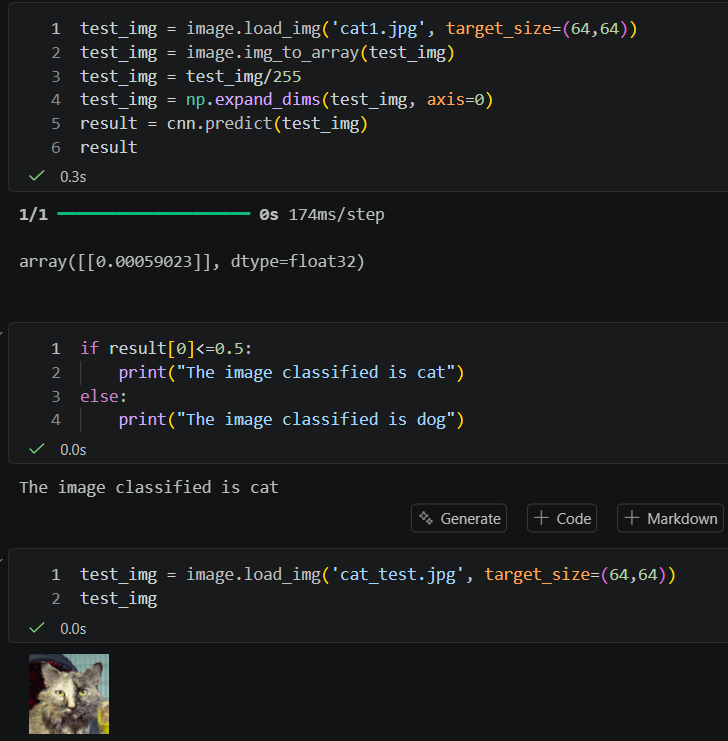
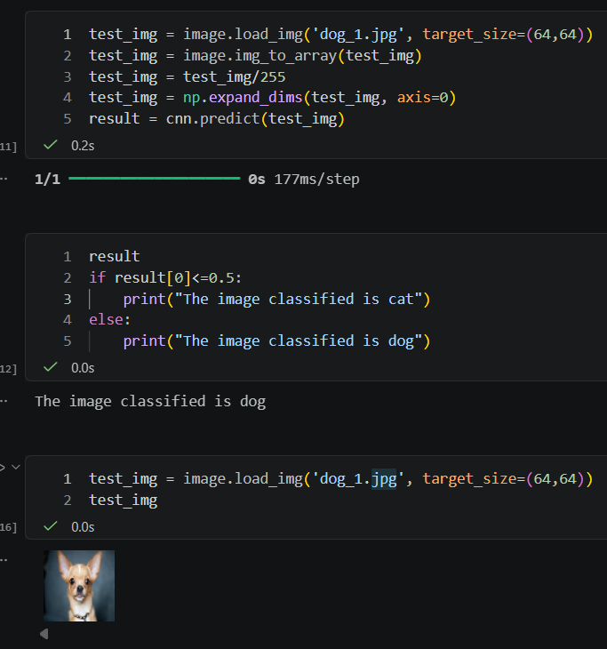

# 🐱🐶 Binary Image Classification using CNN (Cats vs. Dogs)

Can a computer distinguish between a cat and a dog just by looking at an image? This project implements a **Binary Image Classification** model using a **Convolutional Neural Network (CNN)** to classify images into two distinct categories (`Cat` or `Dog`), turning theoretical deep learning concepts into a practical computer vision workflow.

---

## 📌 Project Objective

- **Binary Image Classification:** Build and train a supervised deep learning model that maps input images to one of two target classes (`0` for Cat, `1` for Dog).
- **Automated Feature Extraction:** Use Convolutional and Pooling layers to automatically learn spatial hierarchies (edges, textures, and shapes) directly from raw pixels.
- **Model Generalization:** Evaluate training vs. validation performance to ensure the CNN accurately classifies unseen test images.

---

## 🧠 CNN Architecture & Binary Classification Setup

| Component | Configuration | Purpose |
| :--- | :--- | :--- |
| **Input Layer** | `64 × 64 × 3` (RGB) | Resized and normalized (`[0, 1]`) image tensors |
| **Feature Extraction** | `Conv2D` + `ReLU` + `MaxPooling2D` | Detects visual patterns and reduces spatial dimensions |
| **Classification Head** | `Flatten` + `Dense` (ReLU) | Combines extracted features for classification |
| **Output Layer** | `Dense(1, activation='sigmoid')` | Outputs a probability between `0` and `1` for binary classification |
| **Loss Function** | `binary_crossentropy` | Measures prediction error for two-class classification |
| **Optimizer** | `adam` | Adapts learning rate during backpropagation |

---

## ⚙️ Workflow & Methodology

1. **Data Preprocessing:** Loaded images from class-specific directories (`train/` and `test/`), resized them to **64 × 64** pixels, and scaled pixel values to `[0, 1]`.
2. **CNN Model Development:** Stacked Convolutional (`Conv2D`) and Pooling (`MaxPooling2D`) layers followed by Fully Connected (`Dense`) layers.
3. **Model Training:** Trained the network using `binary_crossentropy` loss so the model learns to separate cat features from dog features.
4. **Evaluation & Inference:** Compared training and validation metrics across epochs and tested the trained model on unseen sample images.

---

## 🖼️ Binary Classification Results

After training, the CNN was tested on unseen sample images and accurately predicted both classes:

| 🐱 Cat Prediction | 🐶 Dog Prediction |
| :---: | :---: |
|  |  |

---

## 🛠️ Technologies Used

- **Programming Language:** Python
- **Deep Learning Framework:** TensorFlow / Keras
- **Numerical Processing:** NumPy
- **Environment:** Jupyter Notebook (`Cats_and_Dogs.ipynb`) & VS Code

---
